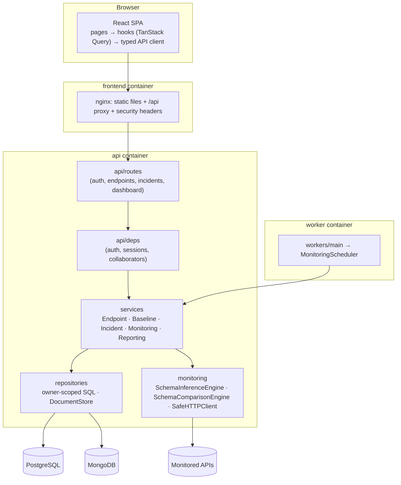

# Architecture

API Drift Radar is a small, layered monolith with one extra process (the worker). There is no message broker and no
microservice split: the API and the worker share the same Python package and the same `MonitoringService`.



## Backend layout

```
backend/app/
  main.py              app factory, CORS, error handlers, /healthz, /readyz
  core/                settings (pydantic-settings), error types + handlers, logging with redaction
  database/            SQLAlchemy engine/session + UTC datetime type; MongoDB client
  models/              SQLAlchemy models and string enums
  schemas/             Pydantic request/response models (requests forbid unknown fields)
  security/            password hashing + JWT, SSRF destination policy, rate limiter
  repositories/        SQL queries (always owner-scoped) and the MongoDB DocumentStore
  monitoring/          schema inference, schema comparison + severity policy, SafeHTTPClient
  services/            business logic: endpoints, baselines, incidents, monitoring pipeline, reporting
  api/                 dependencies and routers
  workers/             MonitoringScheduler and the worker entry point
backend/demo/          clearly-marked demo fixtures (mock upstream + scripted demo)
```

Dependencies point inward: routes → services → repositories/monitoring → models. Nothing in `services` imports from
`api`, and the monitoring engines have no database dependencies at all, which keeps them trivially unit-testable.

## The monitoring pipeline

`MonitoringService.run_check(endpoint_id, trigger)` is the single implementation used by manual checks (API) and
scheduled checks (worker).

```mermaid
sequenceDiagram
    participant C as Caller (API or worker)
    participant MS as MonitoringService
    participant H as SafeHTTPClient
    participant DS as DocumentStore (MongoDB)
    participant PG as PostgreSQL
    C->>MS: run_check(endpoint, trigger)
    MS->>PG: read config (short session, no lock)
    MS->>H: GET url (validated IP, deadline, size cap)
    H-->>MS: FetchResult
    MS->>MS: classify outcome, parse JSON, infer schema
    MS->>DS: upsert schema (content-addressed), insert snapshot (_id = check id)
    MS->>PG: BEGIN; SELECT endpoint FOR UPDATE
    MS->>PG: insert check_result
    MS->>DS: load baseline schema (hash-verified)
    MS->>MS: compare → SchemaDiff
    MS->>DS: upsert diff document
    MS->>PG: create initial baseline / record or clear drift incident / availability incident
    MS->>PG: update endpoint summary; COMMIT
    MS-->>C: CheckResult
```

Design points:

- **No lock is held during the outbound request.** The endpoint row lock is only taken for the short recording
  transaction, and it serialises concurrent manual + scheduled checks of the same endpoint, baseline acceptance and
  incident updates.
- **Outcome classification** (`CheckOutcome`): `success_json`, `success_non_json`, `invalid_json`,
  `unexpected_status`, `timeout`, `network_error`, `blocked` (SSRF policy), `response_too_large`.
- **Three independent signals** are stored per check: request outcome, `is_healthy` (reachable and expected status
  and parseable when it claims JSON) and `schema_status` (`baseline_created`, `compatible`, `drifted`, `unavailable`,
  `not_applicable`). A `200 OK` with a broken schema is *healthy* and *drifted*.
- A failed or non-JSON response never creates or modifies a baseline. A valid non-JSON response *against an existing
  JSON baseline* is reported as a critical `response_structure_changed` (the API stopped returning JSON).

## Schema engine

`SchemaInferenceEngine` turns a JSON value into a normalised node tree:

```json
{"type": "object", "nullable": false, "required": ["active", "user_id"],
 "properties": {"user_id": {"type": "number", "nullable": false},
                "active":  {"type": "boolean", "nullable": false}}}
```

- `int` and `float` → `number` (value changes never look like drift); `bool` is checked before numbers.
- Array items are **merged**: keys missing from some elements leave `required`; `null` elements make items nullable;
  incompatible element types become `mixed`. Empty arrays have `items: null` ("unknown").
- The canonical JSON of the tree is SHA-256 hashed. Equal hashes = identical structure, which short-circuits
  comparison and deduplicates storage.

`SchemaComparisonEngine` walks baseline and observed trees together and emits `SchemaChange(path, kind, rule,
severity, old, new, description)`. Severity comes from a `SeverityPolicy` — a table of rule → severity that can be
overridden per instance:

| Rule                           | Default  | Meaning                                                      |
| ------------------------------ | -------- | ------------------------------------------------------------ |
| `field_removed.required`       | critical | a field present in every baseline instance is gone           |
| `field_removed.optional`       | warning  | a field that was only sometimes present is gone              |
| `field_removed.now_optional`   | warning  | a required field is now missing from some array items        |
| `field_added`                  | info     | a new field appeared                                         |
| `type_changed.incompatible`    | critical | old and new types share nothing                              |
| `type_changed.partial`         | warning  | the field now *sometimes* has a new type                     |
| `nested_structure_changed`     | warning  | an object/array field is now sometimes another shape         |
| `array_item_type_changed`      | warning  | the element type of an array changed                         |
| `nullability_changed.nullable` | warning  | a never-null field is now null                               |
| `nullability_changed.resolved` | info     | a field only ever seen as null now has a concrete type       |
| `response_structure_changed`   | critical | the top-level shape changed (e.g. object → array, or non-JSON) |

Conservative rules: empty arrays never produce changes; narrowing (`number|string` → `number`) is not breaking; a
`null`-only baseline field means "type unknown", so a later concrete type is informational.

## Incidents and baselines

- At most one **open** incident per `(endpoint, type)` (partial unique index + row lock).
- Same drift again (same baseline, same observed hash) → `occurrence_count += 1`, `last_seen_at` updated, *no* new
  history event. Different drift → the open incident is updated and a `changed` event is recorded.
- Drift incidents resolve automatically when responses match the baseline again (`auto_recovered`) or when a new
  baseline is accepted (`baseline_accepted`). Availability incidents resolve on the next healthy check. Manual
  resolution (with a note) is available for both.
- Baseline v1 is created automatically from the first JSON response (`approved_by_id = NULL`). Every later version
  requires `POST /endpoints/{id}/baseline` with a specific `check_id` — the frontend adds a confirmation dialog. The
  previous version is retained with `replaced_at`.

## Scheduler / worker

- `workers/main.py` first acquires a PostgreSQL **advisory lock** on a dedicated connection. A second worker waits as
  a standby, so scaling or restarting never runs two schedulers. If the lock connection dies the worker exits and the
  container restart policy brings it back.
- `MonitoringScheduler.reconcile()` runs every `WORKER_RECONCILE_SECONDS` and makes the in-memory APScheduler job set
  equal to the enabled endpoints in PostgreSQL (add new, reschedule changed intervals, remove paused/deleted). The
  database is the source of truth, so restarts rebuild exactly the same jobs.
- Each job has `max_instances=1` (no overlap per endpoint) and `coalesce=True` (missed runs collapse into one); first
  runs are spread with random jitter; a `ThreadPoolExecutor(MONITOR_MAX_CONCURRENCY)` bounds concurrent requests.
- Database outages: reconcile keeps current jobs and logs a warning; failing checks are logged and retried at the next
  interval. A scheduled check re-reads `is_active` so a pause takes effect immediately even before reconciliation.

## Frontend

- `src/api/client.ts` — typed `fetch` wrapper, consistent `ApiError`, bearer token from `sessionStorage`, global 401
  handler (expired sessions log out consistently and the login page explains why).
- `src/api/hooks.ts` — one TanStack Query hook per endpoint; mutations invalidate dependent queries; lists poll every
  30 s.
- `src/pages/*` — Dashboard, Endpoints, Endpoint form (create/edit), Endpoint detail, Schema comparison, Incidents,
  Incident detail, Login/Register. Chart-heavy pages are lazy-loaded.
- `src/components/*` — badges, stat cards, pagination, form fields, an accessible `<dialog>`-based confirmation, schema
  diff table and schema tree, latency chart.
- `src/utils/validation.ts` mirrors the server's validation for instant feedback; the server remains authoritative.
