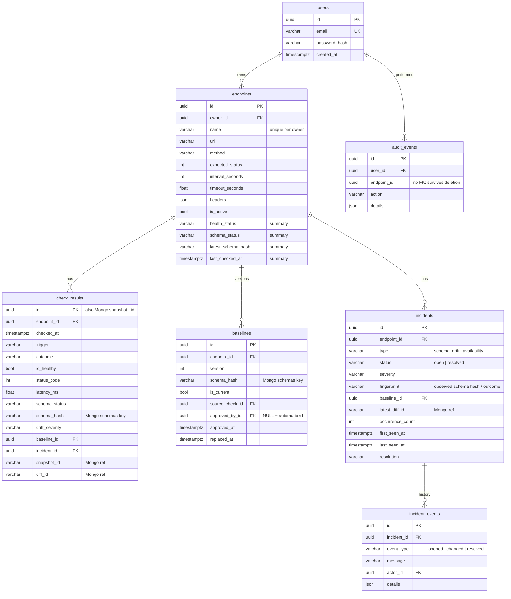

# Database design

Two stores, each used for what it is good at:

- **PostgreSQL** — users, endpoint configuration, check summaries, baseline metadata, incidents, incident history and
  audit events. Needs integrity constraints, joins, row locks and aggregate queries.
- **MongoDB** — raw response snapshots, inferred schemas and diff documents. Arbitrary, nested, third-party shapes;
  write-once; snapshots expire via a TTL index.

## PostgreSQL



### Constraints and indexes

| Object                                   | Purpose                                                              |
| ---------------------------------------- | -------------------------------------------------------------------- |
| `uq_users_email`                         | one account per (lower-cased) email                                  |
| `uq_endpoints_owner_name`                | endpoint names unique per user                                       |
| `uq_baselines_endpoint_version`          | baseline versions are unique and monotonic per endpoint              |
| `uq_baselines_one_current` *(partial: `WHERE is_current`)* | exactly one approved baseline per endpoint         |
| `uq_incidents_one_open` *(partial: `WHERE status = 'open'`)* | no duplicate open incidents per endpoint + type  |
| `ix_check_results_endpoint_checked`      | history pages, metrics windows                                       |
| `ix_incidents_endpoint_status`, `ix_incidents_last_seen` | incident filters and ordering                        |
| `ix_endpoints_owner_id`, `ix_endpoints_is_active` | owner listing, scheduler query                              |

Foreign keys from child tables to `endpoints` are `ON DELETE CASCADE`; references to users/baselines/incidents that
may disappear are `ON DELETE SET NULL`. `check_results` ↔ `baselines`/`incidents` reference each other, so the
migration adds those two foreign keys after both tables exist.

All timestamps use `timestamptz` and are written as UTC (a custom `UTCDateTime` type refuses naive datetimes).

The `endpoints` table carries a small denormalised summary (latest health, schema status, latency…) written only by
the monitoring pipeline. Lists and the dashboard read it without scanning history.

### Migrations

```bash
cd backend
alembic upgrade head          # apply
alembic downgrade base        # roll back everything
alembic check                 # verify models and migrations match
alembic revision --autogenerate -m "describe change"   # new migration (review before committing!)
```

`alembic/env.py` reads only `DATABASE_URL`, so migrations do not need application secrets. In Docker Compose a
one-shot `migrate` service runs `alembic upgrade head` before the API and worker start; Alembic's version table makes
re-running it a no-op.

## MongoDB

| Collection  | `_id`                                         | Content                                                       | Lifetime          |
| ----------- | --------------------------------------------- | ------------------------------------------------------------- | ----------------- |
| `snapshots` | check id (= `check_results.id`)               | `endpoint_id`, `status_code`, `schema_hash`, `body_json`      | TTL (`SNAPSHOT_RETENTION_DAYS`) |
| `schemas`   | `"<endpoint_id>:<schema_hash>"`               | `schema_json` (canonical), `schema_hash`                      | until endpoint deleted |
| `diffs`     | `"<endpoint_id>:<baseline_hash>:<observed_hash>"` | `changes[]` (path, kind, rule, severity, old, new, description), `counts` | until endpoint deleted |

Indexes: `snapshots(endpoint_id, captured_at desc)`, TTL on `snapshots.captured_at`, `schemas(endpoint_id)`,
`diffs(endpoint_id)` — created idempotently at API and worker start-up.

Schemas and bodies are stored as JSON **strings** because their keys come from third-party APIs and may contain `.`
or `$`, which MongoDB field names handle poorly.

## Cross-database consistency

There is no distributed transaction. Instead the design makes every partial failure safe:

1. **Content addressing / deterministic ids.** Schema and diff documents are keyed by hashes, snapshots by the
   pre-generated check id. Writes are idempotent upserts, so retries and races cannot create conflicting documents.
2. **Documents first, then SQL.** MongoDB writes happen before the PostgreSQL transaction, so a committed row never
   points at a document that was never written.
3. **SQL failure → compensate.** If the PostgreSQL transaction fails, the snapshot just written is deleted (best
   effort; otherwise it expires via TTL). Orphaned schema documents are harmless and deduplicated.
4. **MongoDB failure → degrade honestly.** If MongoDB is unavailable the check is still recorded (health, latency,
   status) with `schema_status = unavailable` — never `compatible` — and no baseline is created or changed.
5. **Integrity check on read.** A loaded schema is re-hashed and compared with the hash stored in PostgreSQL; a
   mismatch is treated as unavailable rather than producing a wrong comparison.
6. **Baseline acceptance verifies the document exists** before PostgreSQL points the new baseline at it.
7. **Deletion order.** Endpoint deletion commits in PostgreSQL first (cascade), then removes MongoDB documents; if
   that fails, the documents are unreachable orphans (keyed by a deleted id) and snapshots still expire.

## Bounded history

- Lists are paginated (`page_size` ≤ 100).
- Metrics and dashboards aggregate in SQL (`COUNT`, `AVG`) and only fetch bounded windows of rows (≤ 500 for a
  series, ≤ 5 000 for dashboard buckets).
- Incident history only grows on lifecycle changes, not on every poll.
- Raw snapshots expire automatically.
