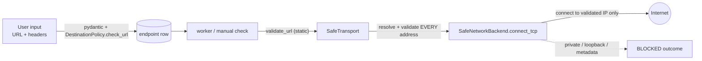

# Security model and threat model

API Drift Radar makes outbound HTTP requests to URLs chosen by its users. That makes **server-side request forgery
(SSRF)** the primary threat; account isolation and secret handling follow.

## Assets and trust boundaries

| Asset                                   | Threat                                                       |
| --------------------------------------- | ------------------------------------------------------------ |
| Internal network, cloud metadata, local services | being reached through the monitor (SSRF)            |
| Other users' endpoints, schemas, incidents | cross-tenant read/modify                                  |
| Passwords, JWT signing key, DB credentials | theft via storage, logs, responses or the repository     |
| The monitor's resources                 | being used to flood a third party or exhaust memory/threads |

Trust boundaries: browser → API (untrusted input), API/worker → monitored URL (untrusted destination and response),
API/worker → databases (trusted, private network).

## SSRF controls

### 1. Static URL rules (`app/security/ssrf.py: validate_url`)

Applied at registration, on every edit and again before every request:

- scheme must be `http` or `https`;
- no `user:pass@` credentials, no `@` in the authority, no backslashes, whitespace or control characters;
- URL ≤ 2048 characters; host must be present and IDNA-encodable;
- hostnames `localhost`, `metadata`, `metadata.google.internal`, `instance-data`, single-label hosts and suffixes
  `.localhost .local .internal .localdomain .home.arpa .lan` are rejected;
- numeric shorthand hosts (`2130706433`, `0x7f.1`, `0177.0.0.1`) are rejected;
- IP-literal hosts must be public (see below);
- ports: 80, 443 or ≥ 1024 (blocks SSH, SMTP, database ports on public hosts).

### 2. Address validation (`is_public_ip`)

An address is allowed only if Python considers it *global* **and** it is not multicast, reserved or unspecified **and**
not in an explicit deny list. Covered: loopback (`127/8`, `::1`), RFC 1918, link-local (`169.254/16` incl. cloud
metadata `169.254.169.254`, `fe80::/10`), CGNAT `100.64/10` (incl. Alibaba metadata `100.100.100.200`), unique-local
`fc00::/7` (incl. AWS IPv6 metadata `fd00:ec2::254`), `0/8`, benchmarking `198.18/15`, IETF `192.0.0/24`, deprecated
site-local `fec0::/10`. IPv4-mapped IPv6 (`::ffff:a.b.c.d`) is unwrapped; NAT64 (`64:ff9b::/96`, `64:ff9b:1::/48`),
6to4 (`2002::/16`) and Teredo (`2001::/32`) — which embed IPv4 addresses and which Python reports as global — are
blocked outright.

### 3. Connection-level enforcement (DNS rebinding / TOCTOU)

Validating a hostname at registration is not enough: DNS can answer differently at request time. The monitor
therefore installs a custom `httpcore` network backend (`SafeNetworkBackend`) into httpx's connection pool:

1. `connect_tcp(host, port)` resolves the host itself;
2. if **any** returned address is non-public, the whole destination is rejected (an attacker cannot mix a public and
   a private record);
3. it connects to exactly the validated address(es) — there is no second lookup that could differ;
4. TLS is then negotiated for the *original hostname* (SNI and certificate verification are unchanged).

If httpx's internals change so the backend cannot be installed, `SafeTransport` raises at start-up instead of silently
running unprotected (fail closed). Tests prove the behaviour against a real socket: a hostname that resolves publicly
at registration but to `127.0.0.1` at request time is blocked (`tests/test_ssrf.py`).

### 4. Request behaviour

- **Redirects are never followed** (a 3xx is recorded as the observed status), so a public URL cannot bounce to an
  internal one.
- `trust_env=False`: `HTTP(S)_PROXY`, `NO_PROXY`, `.netrc` etc. are ignored — a proxy would bypass IP validation.
- TLS verification is always on; there is no option to disable it.
- Only `GET`; retries (default 1, max 3) only for connect errors and timeouts, with backoff.
- Total-time deadline per request (not just per socket operation), so slow-drip responses are cut off.
- Response bodies are streamed and capped at `MONITOR_MAX_RESPONSE_BYTES` *after* decompression (gzip bombs) and
  rejected early when `Content-Length` is too large.
- Bounded connection pool, `MONITOR_MAX_CONCURRENCY` worker threads, `MONITOR_MIN_INTERVAL_SECONDS` (30 s),
  per-endpoint manual-check cooldown and a per-user manual-check rate limit.

### 5. What is sent to monitored endpoints

Only the endpoint's own configured headers, `User-Agent: APIDriftRadar/1.0` and `Accept`. Never cookies, the user's
JWT, application secrets or environment data. Users cannot set `Host`, `Content-Length`, `Transfer-Encoding`,
`Connection`, `Upgrade`, `TE`, `Trailer`, `Keep-Alive`, `Expect`, `Forwarded`, `X-Real-IP`, `X-Forwarded-*`, `Proxy-*`
or `Sec-*` headers; header values with CR/LF/NUL are rejected (no header injection).

### 6. The frontend cannot bypass this

The browser only ever calls the API. All checks run server-side through the same `MonitoringService` and
`SafeHTTPClient`; client-side validation is a convenience, not a control.

### Demo exemption

`MONITOR_ALLOWED_HOSTS` lists **exact hostnames** that skip the public-IP rule (used only so the demo can monitor the
`mock-api` container on the private Docker network). It is empty by default, matches exactly (no suffix matching) and
must stay empty in any real deployment.

## Authentication and authorisation

- Passwords: Argon2id (`argon2-cffi` defaults), 10–128 characters. Login verifies against a dummy hash when the user
  does not exist, so response time does not reveal registered emails; the error message is identical either way.
- Tokens: HS256 JWTs with `sub`, `iat`, `exp`, `type=access`; expiry is required; signature, expiry and type are
  checked on every request. `JWT_SECRET` must be ≥ 32 characters and the placeholder value is refused at start-up.
- Authorisation: every query that touches endpoints, checks, baselines or incidents is filtered by `owner_id` in the
  repository layer, so another user's resources are simply "not found" (404, which also avoids leaking existence).
  Integration tests exercise every route with a second user.
- Mass assignment: request models use `extra="forbid"`; server-managed fields (`owner_id`, health, schema status…)
  are not part of any input model.
- Rate limits: login (per IP + email) and registration (per IP), manual checks (cooldown + per-user limit).

## Data handling

- Error responses use one envelope (`{"error": {"code", "message", "details"}}`); unhandled exceptions return a generic
  500 and are logged by type only. Validation errors do not echo submitted values (passwords).
- A logging filter redacts bearer tokens, `password=`/`token=`/`api_key=`-style pairs and credentials in connection
  URLs. httpx request logging is silenced.
- Network error messages from monitored hosts are reduced to the exception class (plus a TLS hint), avoiding leaking
  internal details back to users.
- No secrets in the repository: `.env` files are git-ignored; examples contain empty values; CI uses throwaway
  credentials for ephemeral containers.
- CORS: explicit origin allow-list, no credentials mode; the bundled nginx proxy makes the app same-origin anyway.
- nginx sends a strict CSP (`script-src 'self'`), `X-Frame-Options: DENY`, `nosniff`, `Referrer-Policy: no-referrer`.
- Containers run as non-root; PostgreSQL and MongoDB ports are not published to the host; MongoDB requires auth.

## Known limitations and residual risks

- **Custom request headers are stored in plaintext** and returned to their owner. Treat them as low-sensitivity, or add
  encryption at rest before storing production credentials.
- **Tokens in `sessionStorage`** are readable by any script on the origin; the CSP reduces XSS risk but does not
  eliminate it. No refresh tokens or server-side revocation.
- **Rate limiting is per process** and keyed by the client IP seen by uvicorn; behind the bundled nginx all clients
  share the proxy IP for the registration limit (login is also keyed by email). Uvicorn only trusts forwarded headers
  from `127.0.0.1` by default — configure `--forwarded-allow-ips` deliberately if you deploy behind another proxy.
- **DNS resolution is synchronous** via the OS resolver and not covered by the request timeout.
- **Response bodies are stored** (as snapshots, for `SNAPSHOT_RETENTION_DAYS`). Monitored APIs that return personal
  data will have it stored in MongoDB.
- Public destinations remain reachable by design: a user can still direct (rate-limited, GET-only) traffic at any public
  host.
